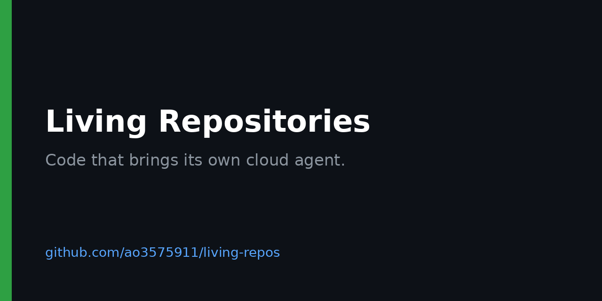

# Living Repositories
Code that brings its own cloud agent.
Examples + demos for per-repo cloud agent runtimes.

Runnable examples of the Living Repositories Protocol, each validated against a pinned protocol release in CI.

<!-- BEGIN GENERATED: badges -->

[](https://github.com/ao3575911/living-repos/actions/workflows/ci.yml) [](https://github.com/ao3575911/living-repos/releases) [](https://github.com/ao3575911/living-repos-protocol/releases/tag/v0.3.0) [](LICENSE)

<!-- END GENERATED: badges -->



## What it is

A showcase of repositories that carry their own cloud agent runtime. Each example declares a `.living/manifest.yaml` that follows the [Living Repositories Protocol](https://github.com/ao3575911/living-repos-protocol). The protocol repo defines the standard; this repo shows implementations.

## Hello demo

[`examples/hello`](examples/hello) is a working example: `cd examples/hello && python bootstrap.py`. CI runs it on every change, inside a container that matches its `isolation_profile` (`bash scripts/run_isolated.sh examples/hello`, needs Docker).

## Examples

<!-- BEGIN GENERATED: examples -->

| Example | Capabilities | Isolation | State target |
| --- | --- | --- | --- |
| [`_template`](https://github.com/ao3575911/living-repos/tree/main/examples/_template) | run_tasks, publish_state | dedicated-vm | control-process |
| [`hello`](https://github.com/ao3575911/living-repos/tree/main/examples/hello) | run_tasks, publish_state | sandbox-process | file |
| [`snapshot`](https://github.com/ao3575911/living-repos/tree/main/examples/snapshot) | run_tasks, snapshot_restore | sandbox-process | control-process |

Generated from each example's manifest by `scripts/gen_readme.py`.

<!-- END GENERATED: examples -->

## Quickstart

```sh
git clone https://github.com/ao3575911/living-repos
cd living-repos
cp -r examples/_template examples/my-example
# edit examples/my-example/.living/manifest.yaml, then validate:
pip install -r requirements-ci.txt
python scripts/validate_examples.py
```

## Docs

Docs site: [https://ao3575911.github.io/living-repos/](https://ao3575911.github.io/living-repos/)

- [Strategy](STRATEGY.md): problem, audience, non-goals and alternatives

- [PRD](docs/prd.md), [spec sheet](docs/spec-sheet.md), [architecture](docs/architecture.md)
- [Build plan](docs/build-plan.md), [roadmap](docs/roadmap.md), [risks](docs/risks.md), [QA strategy](docs/qa-strategy.md)
- [ADR-0001: repo split](docs/decisions/ADR-0001-repo-split.md)
- [Protocol compatibility](PROTOCOL.md)
- [Changelog](CHANGELOG.md)

## Status

v0.3.0: hello and snapshot demos plus the example template, pinned to protocol release v0.3.0. Next: running demos in their declared isolation profile (see the [roadmap](docs/roadmap.md)).

## Related

- [living-repos-protocol](https://github.com/ao3575911/living-repos-protocol): the canonical specification and manifest schema.

## Licence

[MIT](LICENSE). See [CONTRIBUTING.md](CONTRIBUTING.md) to contribute.
